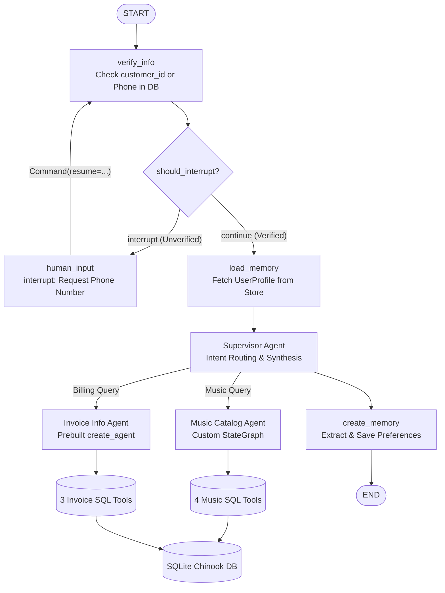
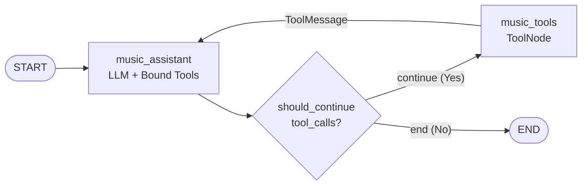

# 🎵 LangGraph Multi-Agent Customer Support System

A modular, production-structured Python implementation of the **LangGraph Multi-Agent Customer Support** workflow (modeled on LangChain's `multi_agent.ipynb`). This application coordinates specialist AI agents, Human-in-the-Loop (HITL) identity verification, SQLite database querying, and long-term customer preference memory.

---

## 🏗️ System Architecture

Rather than using a single monolithic prompt, this system separates responsibilities across specialized LangGraph nodes and sub-agents:

1. **Human-in-the-Loop (HITL) Verification (`workflow/verification.py`):** Pauses execution via `interrupt()` to verify a customer's registered phone number against the Chinook database before exposing sensitive billing records.
2. **Long-Term Memory (`workflow/memory.py`):** Uses LangGraph's `BaseStore` (`InMemoryStore`) and Pydantic structured outputs (`UserProfile`) to extract, deduplicate, and reload customer music preferences across turns.
3. **Supervisor Agent (`agents/supervisor.py`):** Interprets user intent, routes sub-tasks to one or both specialist sub-agents, and synthesizes a unified response.
4. **Music Catalog Sub-Agent (`agents/music_agent.py`):** Built manually using LangGraph's `StateGraph`, `ToolNode`, and conditional routing to query artists, albums, tracks, and genres.
5. **Invoice Information Sub-Agent (`agents/invoice_agent.py`):** Built using LangChain's prebuilt `create_agent()` helper with `ToolRuntime` state injection to securely retrieve customer-scoped invoices and support rep details.

### Main Orchestration Flow



### Music Sub-Agent Internal Loop



---

## 📁 Project Structure

```text
langgraph_multi_agent/
├── agents/
│   ├── __init__.py
│   ├── music_agent.py       # Custom StateGraph music catalog specialist
│   ├── invoice_agent.py     # Prebuilt create_agent() billing specialist
│   └── supervisor.py        # Multi-agent coordinator & sub-agent tools
├── database/
│   ├── __init__.py
│   ├── chinook.py           # Auto-downloads & initializes SQLite Chinook DB
│   └── tools.py             # Parameterized SQL tools (4 music, 3 invoice)
├── workflow/
│   ├── __init__.py
│   ├── state.py             # Shared MessagesState + verification & memory fields
│   ├── verification.py      # interrupt() phone verification node & router
│   ├── memory.py            # Structured UserProfile load/create functions
│   └── graph.py             # Compiles full StateGraph + checkpointer + store
├── utils/
│   ├── __init__.py
│   └── models.py            # Centralized init_chat_model('openai:gpt-4o-mini')
├── data/
│   └── chinook.db           # Auto-generated SQLite sample database on first run
├── main.py                  # CLI execution entrypoint & interrupt handler
├── requirements.txt         # Python package dependencies
├── .env.example             # Environment variable template
├── .env                     # Local secrets (git-ignored)
└── .gitignore               # Git exclusion rules
```

---

## ⚙️ Prerequisites & Installation

* **Python:** `3.11` or higher
* **OpenAI API Key:** Required for `gpt-4o-mini` reasoning and structured preference extraction
* **LangSmith API Key:** *(Optional)* For tracing and evaluation

### 1. Clone or Create the Project Workspace

```bash
mkdir langgraph_multi_agent
cd langgraph_multi_agent
```

### 2. Create and Activate a Virtual Environment

**Windows (PowerShell):**
```powershell
python -m venv venv
.\venv\Scripts\Activate.ps1
```

**Windows (CMD):**
```cmd
python -m venv venv
venv\Scripts\activate
```

**macOS / Linux:**
```bash
python3 -m venv venv
source venv/bin/activate
```

### 3. Install Dependencies

```bash
pip install -r requirements.txt
```

*(Optional)* Lock exact dependency versions once verified:
```bash
pip freeze > requirements-lock.txt
```

### 4. Configure Environment Variables

Copy `.env.example` to `.env` and insert your OpenAI API key:

```env
OPENAI_API_KEY=sk-your-actual-openai-api-key
LANGSMITH_API_KEY=your_langsmith_api_key
LANGSMITH_TRACING=false
LANGSMITH_PROJECT=langgraph-multi-agent
```

---

## 🚀 Running the Application

Start the interactive CLI assistant from the project root:

```bash
python main.py
```

On the first run, `database/chinook.py` will automatically fetch the official Chinook SQL schema and build `data/chinook.db`.

```text
Downloading Chinook database SQL...
Chinook database created successfully.

===================================
 LANGGRAPH MULTI-AGENT CUSTOMER SUPPORT
===================================

Type 'exit' to stop.

Customer:
```

---

## 🧪 Verification & Test Scenarios

Use a valid phone number from the Chinook `Customer` table (for example, `+55 (12) 3923-5555` for Customer ID `1`) to test the full workflow:

| Test Scenario | Sample Customer Input | Expected Workflow & Output |
| :--- | :--- | :--- |
| **1. Customer Verification (HITL)** | `"What is my latest invoice?"` | Graph pauses via `interrupt()`, prompts for registered phone number, validates against SQLite, and resumes. |
| **2. Invoice Specialist** | `"What was my most recent invoice?"` | Supervisor routes to **Invoice Agent**, querying `get_invoices_by_customer_sorted_by_date` using the verified `customer_id`. |
| **3. Music Catalog Specialist** | `"What albums are available by AC/DC?"` | Supervisor routes to **Music Agent**, returning *For Those About To Rock We Salute You* and *Let There Be Rock*. |
| **4. Multi-Agent Delegation** | `"How much was my latest purchase? Also show albums by the Rolling Stones."` | Supervisor delegates to **both** sub-agents and combines the billing total and Rolling Stones discography into one answer. |
| **5. Long-Term Memory** | Turn 1: `"I love rock music and particularly like the Rolling Stones."`<br/>Turn 2: `"Recommend some music based on my preferences."` | `create_memory` extracts and saves preferences to `InMemoryStore`; `load_memory` injects them into the Music Agent on Turn 2. |

---

## 🔒 Security & Production Notes

* **SQL Injection Protection:** All queries in `database/tools.py` and `workflow/verification.py` use parameterized SQLite placeholders (`?`) rather than string formatting.
* **Persistent Storage:** This implementation uses LangGraph's `MemorySaver` and `InMemoryStore` for local execution. For production deployments, replace them with persistent database-backed checkpointers and stores (e.g., PostgreSQL) and upgrade phone-number lookup to multi-factor authentication (such as OTP verification).
